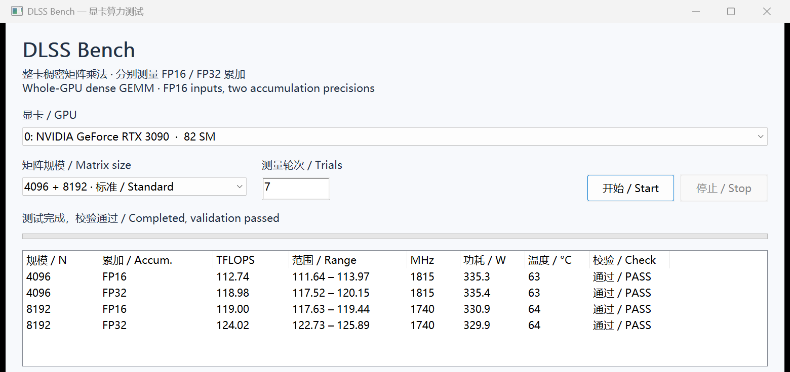

# DLSS Bench

在尝试 GPU unlock 前，先测量实际 Tensor Core 吞吐，帮助判断当前是否需要解除相应的算力限制。Windows 原生独立程序，用户只需 Windows x64 和兼容的 NVIDIA 驱动。

A native Windows benchmark to measure Tensor Core throughput before attempting GPU unlock and help decide whether the relevant throughput limit needs unlocking. Users only need Windows x64 and a compatible NVIDIA driver.

[下载 Windows 预览版 / Download Windows preview](https://github.com/cloudvisionx/DLSSBench/releases/tag/v1.1.0)



RTX 3090 实测截图：FP16 输入，分别使用 FP16 / FP32 累加，每项 7 轮。1.1 界面直接显示理论峰值、实测占比和是否超过 50%；截图来自一次运行，不是解锁前后对照。

Actual RTX 3090 screenshot: FP16 inputs, separate FP16 / FP32 accumulation, seven trials per configuration. Version 1.1 shows the reference peak, measured percentage and whether throughput exceeds 50%. This is one run, not a before/after unlock comparison.

## 下载与运行 / Download and run

1. 打开本仓库的 **Releases** 页面，下载 `DLSSBench-1.1-win64.zip`。
2. 解压后双击 `DLSSBench.exe`，选择 GPU，点击 **开始 / Start**。
3. 点击 **Reports** 查看自动保存的 JSON / CSV。

Download `DLSSBench-1.1-win64.zip` from **Releases**, extract it, and run `DLSSBench.exe`. Select a GPU and click **Start**. **Reports** opens the saved JSON and CSV files.

无需安装 Python、CUDA Toolkit、cuBLAS、Qt 或 VC++ Redistributable。程序内置计算内核与 C++ 运行时代码。

No separate Python, CUDA Toolkit, cuBLAS, Qt or Visual C++ Redistributable installation is required. GPU kernels and the C++ runtime are embedded.

## 测量内容 / What it measures

- 稠密矩阵乘法 `C = A × B`，FP16 输入与输出，分别使用 FP16 和 FP32 累加。
- 原生中英文界面，可选择显卡、矩阵规模和测量轮次。
- 显示 TFLOPS、逐轮范围及可用的驱动传感器数据。
- 显示满速稠密 FP16 理论峰值、实测占比和是否超过该峰值的 50%。
- 后台保留输出位置抽查、内存保护区检查和取消功能；正确性细节写入报告。

Dense FP16-input/output GEMM with separate FP16 and FP32 accumulation. The bilingual GUI shows throughput, the full-rate dense FP16 reference peak, peak percentage and the >50% comparison. Numerical spot checks and memory guards remain active, with details in JSON/CSV reports.

名称为 DLSS Bench；当前版本测量矩阵计算吞吐，不测量 DLSS 游戏帧率或图像质量。

The current version measures matrix-compute throughput. It does not benchmark DLSS game frame rates or image quality.

## 是否需要 GPU unlock？ / Do I need GPU unlock?

**先测试，再决定。若本次启动没有执行过 unlock，且校验通过的持续吞吐明显超过该卡、该累加精度在相应运行频率下的受限上限，就无需为解除这项吞吐限制再执行 unlock。**

**Test first. If no unlock tool has run during this boot and validated, sustained throughput clearly exceeds the capped ceiling for your GPU, accumulation precision and operating clocks, there is no need to unlock that throughput limit.**

- 分别看 **FP16 累加**和 **FP32 累加**。FP16 累加的高分不能代替 FP32 累加的判断；两项输入均为 FP16。
- 低于或接近受限上限，不能直接判定需要解锁：频率、功耗、温度、后台负载、矩阵大小和内核效率也会影响分数。
- 解锁后测到高分，只说明当前启动会话的性能；要判断能否省略 unlock，应在确认没有执行解锁的启动中测试。

Check **FP16 and FP32 accumulation separately**; both use FP16 inputs. A low or borderline score is inconclusive because clocks, power, temperature, background load, matrix size and kernel efficiency also affect throughput. A high post-unlock score describes the current boot; deciding whether unlock can be skipped requires a boot in which no unlock tool has run.

以 RTX 3090 为例：在 1740 MHz 参考频率下，满速稠密 FP16 峰值为 **146.10 TFLOPS**，其一半约为 **73.05 TFLOPS**；截图的 FP32 累加实测约 **124.56 TFLOPS / 85.3%**。两种累加共用满速 FP16 参考，不能把受限 FP32 累加峰值当成分母。73.05 不是所有显卡、所有频率的固定阈值。

For an RTX 3090 at a reference clock of 1740 MHz, the full-rate dense FP16 peak is **146.10 TFLOPS** and half is about **73.05 TFLOPS**. The screenshot reports **124.56 TFLOPS / 85.3%** for FP32 accumulation. Both modes share the full-rate FP16 reference; the denominator is not the capped FP32 peak. 73.05 is not a universal cutoff for other GPUs or clocks.

1.1 自动计算 SM 8.6 / 8.9 的峰值占比；缺少有效频率或未建立架构模型时显示未知。频率为 NVML 批次后采样，因此这是参考比较，不会自动判定锁定状态，也不会执行 unlock。频率上界、计算公式及判断边界见 [GPU unlock 判断指南](docs/GPU_UNLOCK_CHECK.md)。

Version 1.1 computes peak percentages for SM 8.6 / 8.9; missing clocks or an unknown architecture model produce an unavailable result. Clocks are post-batch NVML samples, so this is a reference comparison, not automatic lock detection. The app does not perform an unlock. See the [GPU unlock decision guide](docs/GPU_UNLOCK_CHECK.md) for clock bounds, formulas and interpretation limits.

## 兼容性与结果解释 / Compatibility and interpretation

峰值模型覆盖 RTX 30 / 40 系（驱动实际报告的 SM 8.6 / 8.9），包含 Ti、SUPER、显存变体及 Laptop；从驱动读取实际 SM 数和频率，不依赖逐型号白名单。每 SM 每周期 1024 FLOPs 的依据、官方链接和覆盖说明见 [理论峰值的来源与 30 / 40 系覆盖](docs/THEORETICAL_PEAK.md)。

The peak model covers RTX 30 / 40 GPUs reporting SM 8.6 / 8.9, including Ti, SUPER, memory variants and laptops, using actual SM counts and clocks rather than a name whitelist. See [peak sources and RTX 30 / 40 coverage](docs/THEORETICAL_PEAK.md) for the official basis of the 1024 FLOPs/SM/cycle coefficient and coverage details.

已在 RTX 3090（SM 8.6）、NVIDIA 驱动 616.56 上验证。当前构建要求 SM 8.6 或更新架构；其他架构通过驱动 JIT 执行内嵌 PTX，尚未实测。较旧驱动可能不支持内嵌 PTX 8.7。

Tested on RTX 3090 / SM 8.6 with driver 616.56. This build requires SM 8.6 or newer; driver-JIT execution on other architectures is untested. Older drivers may not support the embedded PTX 8.7.

TFLOPS 来自固定 GEMM 内核，不代表所有算法中的硬件绝对峰值。当前没有同条件的解锁前基线，不能单独据此推导解锁提升比例。数值检查为抽查，不是全矩阵稳定性验证。

Results come from a fixed GEMM backend, not an exhaustive hardware peak search. No matched pre-unlock baseline is available; these results alone do not establish an unlock speedup. Numerical checks are sampled rather than exhaustive.

## 第三方许可 / Third-party notices

内嵌 GEMM 内核参考 Triton 的 MIT 许可矩阵乘法教程；许可保留在 [THIRD_PARTY_NOTICES.txt](THIRD_PARTY_NOTICES.txt)、发布 ZIP 和程序 About 中。

The embedded GEMM kernels derive from Triton's MIT-licensed matrix multiplication tutorial. Notices are included in this repository, the release ZIP and the app's About dialog.

## 源码与构建 / Source and build

- `src`: Win32 GUI, CUDA Driver API backend, timing, validation and report export.
- `kernels/fp16_native_kernel.py`: FP16-input GEMM with FP16 / FP32 accumulation.
- `kernels/generated`: validated embedded GPU kernels and their manifest.
- `tools/build.ps1`: standalone MSVC build; `tools/build_kernels.py`: optional GPU kernel rebuild.

开发机需要 MSVC C++ 工具、Windows SDK 和 CUDA 开发头文件。普通构建使用仓库内的预编译内核，无需 Python 或 Triton。运行成品仍只需 Windows 和 NVIDIA 驱动。

Developers need MSVC, a Windows SDK and CUDA development headers. Normal builds use the checked-in kernels and need no Python or Triton. End users still need only Windows and the NVIDIA driver.

```powershell
powershell -NoProfile -ExecutionPolicy Bypass -File tools\build.ps1
```

[完整构建与验证说明 / Build and verification guide](docs/BUILD.md)

应用源码目前未另行指定项目级许可证；第三方部分保留其原有 MIT 许可。

No project-wide license has been selected for the application source; third-party components retain their original MIT license.
